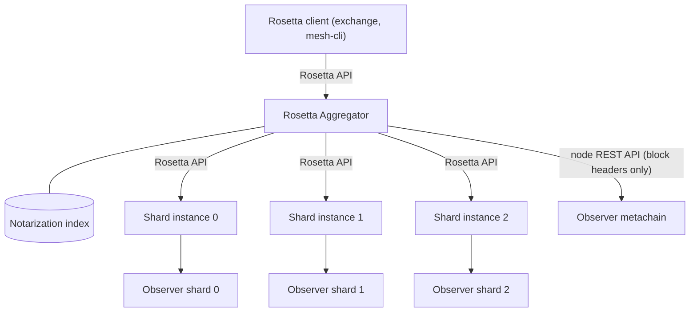

# Rosetta Aggregator: design

This is the specification of the middle application chosen in [CROSS_SHARD_ANALYSIS.md](CROSS_SHARD_ANALYSIS.md). Read that document first for the reasoning; this one says what to build.

Status: implemented in this repository (`aggregator/`, `cmd/rosetta-aggregator/`) and tested against mocks and a simulated network only. It has not been run against a real network. Section 16 lists what is built, what differs from the original proposal, and what is left. Code blocks in sections 6 and 7 are sketches of intent; the code is the reference.

## 1. Summary and terms

The Rosetta Aggregator is a Rosetta server that presents all MultiversX shards as one chain. It sits in front of one existing Rosetta instance per shard and reads block ordering from a metachain observer.

| Term | Meaning |
|---|---|
| Shard instance | The existing `rosetta` binary of this repository, observing one shard. Unchanged. |
| Unified chain | The chain the aggregator serves. Its blocks correspond one to one to metachain blocks. |
| Unified block N | Index N and hash of metablock N. Contains the transactions of all shard blocks notarized by metablock N. |
| Frontier of shard S at N | The last block of shard S notarized by metablocks up to N. Written `f_S(N)`. |
| Leg | One of the two appearances of a cross-shard transaction: the source leg in the sender's shard, the destination leg in the receiver's shard. |
| Served shard | A shard for which a shard instance is configured. At first: all regular shards, not the metachain. |

## 2. Architecture



### Components

| Component | Responsibility |
|---|---|
| HTTP front end | Rosetta controllers and request asserter from `rosetta-sdk-go/server`, as in the shard instance. |
| Shard map | Pure function from address to shard, identical to the protocol's (`ComputeIdFromBytes`). Decides routing and whether an address is observed. |
| Shard backends | One Rosetta client per shard (`rosetta-sdk-go/fetcher`), with health checks and optional fail-over between several URLs of the same shard. |
| Metachain source | Reads metablocks from a metachain observer: nonce, hash, previous hash, timestamp, epoch, and the list of notarized shard blocks. Reads the highest final metablock nonce. |
| Notarization index | Maps each metablock nonce to the shard blocks it notarizes and to each shard's frontier. Derived data, kept in an embedded key-value store. |
| Block assembler | Builds a unified block from shard blocks: fetch, verify, classify legs, link, order. |
| Services | The Rosetta endpoints, implemented on top of the parts above. |

### Deployment

- One observer per shard plus one metachain observer. The shard observers are configured as the README describes (historical state, `DbLookupExtensions`). The metachain observer does not need historical account state, because the aggregator reads only block headers from it.
- One shard instance per shard, in online mode, reachable only from the aggregator.
- One aggregator. It is the only component exposed to clients.
- For offline signing environments: the aggregator in offline mode with a single shard instance in offline mode behind it.

All shard instances must run with the same network settings, the same custom-currency file and the same `--handle-contracts` value. The aggregator is given the same values in its own configuration.

## 3. The unified chain

### 3.1 Block identity

| Field | Value |
|---|---|
| `block_identifier.index` | Metablock nonce N |
| `block_identifier.hash` | Metablock hash |
| `parent_block_identifier` | Metablock N − 1 |
| `timestamp` | Metablock timestamp, in milliseconds |
| `metadata` | `epoch`, `round`, and `shardBlocks`: the list of `{shard, nonce, hash}` included |

Index and hash equal those of the proxy's hyperblock N and of the metablock on the explorer, so any unified block can be cross-checked from outside.

### 3.2 Content

For each served shard S, unified block N contains the transactions of shard blocks `f_S(N−1) + 1 … f_S(N)`. The range is empty when metablock N notarizes nothing from S. A unified block with no transactions is valid.

Example, with three shards:

| Unified block | Shard 0 blocks | Shard 1 blocks | Shard 2 blocks |
|---|---|---|---|
| 5000 | 1000 | 997 | 1003, 1004 |
| 5001 | 1001 | — | 1005 |
| 5002 | 1002 | 998, 999 | 1006 |

A balance query for a shard 1 account at unified block 5001 is answered from shard 1 block 997, the frontier.

### 3.3 Tip

The aggregator serves block N only when it can never change and every part of it can be fetched:

```
tip = the largest indexed N such that
        N <= highest final nonce reported by the metachain observer, and
        for every served shard S:  f_S(N) <= current block index of shard instance S
```

Shard instances already serve only blocks that are final and executed, a little behind their observer. The unified tip therefore trails the metachain by a few rounds. It only moves forward. The unified chain has no reorganisations.

### 3.4 Oldest block

Shard instances keep historical balances for a limited number of epochs and report their own `oldest_block_identifier`. The aggregator reports:

```
oldest = the smallest indexed N such that
           for every served shard S:  f_S(N) >= oldest block index of shard instance S
```

### 3.5 Genesis

The unified genesis block is metablock 0. Its transactions are the genesis transactions of all shard instances, each of which already lists the genesis balances of its own shard. Its identifier is configured, like `--genesis-block` on the shard instance.

## 4. Transactions and legs

### 4.1 Classification

Shard instances attach `sourceShard`, `destinationShard`, `miniblockType`, `value` and `receiver` to the metadata of ordinary transactions, invalid transactions and smart contract results (`server/services/transactionMetadata.go`). The aggregator classifies each transaction returned by the instance of shard S using only that metadata:

| Case | Condition | Treatment |
|---|---|---|
| Local | No shard metadata, or source = destination | Passed through unchanged. |
| Source leg | source = S, destination ≠ S | Identifier unchanged. Forward link added when the destination leg is certain (4.3). |
| Destination leg | destination = S, source ≠ S, source shard is served | Identifier becomes `<hash>-dst`. Backward links and leg metadata added. |
| Incoming from an unserved shard | destination = S, source ≠ S, source shard not served | Passed through unchanged. No source leg can exist. |

Transactions without shard metadata are rewards, fee refunds and receipts. Each has operations for a single account, so each appears with operations in one shard only and needs no leg handling.

The rule is deterministic and uses nothing but the transaction itself. In particular it does not depend on whether the other leg had any operations.

### 4.2 Identifiers and links

| | Source leg | Destination leg |
|---|---|---|
| `transaction_identifier.hash` | `T` (the real hash) | `T-dst` |
| `related_transactions` | `{T-dst, forward}` when certain | `{T, backward}`, and `{original, backward}` when the metadata names a different original transaction |
| Added metadata | `crossShard: {leg: "source", sourceShard, destinationShard}` | `crossShard: {leg: "destination", hash: T, sourceShard, destinationShard}` |

Smart contract results are linked into the same structure: any transaction whose metadata has `originalTransaction` gets a backward link to it. Following links from `T` then reaches its destination leg and every result it produced, in whichever shard.

The suffix uses `-` because the SDK's storage builds keys by joining identifiers with `/`.

### 4.3 When the destination leg is certain

A forward link is a promise that the destination leg will appear. If it never did, tooling would wait for it forever. A shard instance drops transactions that end up with no operations, so the promise can only be made when the destination leg is known to carry one.

**Initial rule.** The forward link is added when all of these hold:

- `miniblockType` is `TxBlock` (an ordinary transaction, not in an invalid miniblock);
- `value` is greater than zero;
- the receiver's shard is served and the receiver is an observed address (a user account, or a contract when contracts are handled).

Under these conditions the destination shard emits a `Transfer` operation for the receiver whether the transfer succeeds or fails there; a failed one is marked with status `Failure` (`server/services/failedMoveBalance.go`). This covers what the Construction API builds for the native currency.

**Exact rule, after an upstream change.** If shard instances are given an option to keep cross-shard destination transactions even when they have no operations (section 11, U1), the rule becomes simply: the destination shard is served and the transaction is not in an invalid miniblock. Custom-currency transfers and contract calls then get forward links too.

### 4.4 Order and uniqueness inside a unified block

Transactions are ordered by shard, then by shard block nonce, then by their position in the shard instance's response.

After classification no identifier should occur twice in a unified block, because the two legs always fall in different blocks (analysis, section 3). The assembler still checks. If it finds a duplicate, it merges the two into one transaction by concatenating and re-indexing the operations, and increments a counter that should stay at zero.

### 4.5 Worked example

Alice (shard 0) sends 1 EGLD to Bob (shard 1). The fee is 0.00005 EGLD. Shard 0 executes the transaction in block 1000, notarized by metablock 5000. Shard 1 executes it in block 998, notarized by metablock 5002.

Unified block 5000:

```json
{
  "transaction_identifier": { "hash": "a1b2…" },
  "operations": [
    { "operation_identifier": { "index": 0 }, "type": "Transfer", "status": "Success",
      "account": { "address": "erd1…alice" }, "amount": { "value": "-1000000000000000000", "currency": { "symbol": "EGLD", "decimals": 18 } } },
    { "operation_identifier": { "index": 1 }, "type": "Fee", "status": "Success",
      "account": { "address": "erd1…alice" }, "amount": { "value": "-50000000000000", "currency": { "symbol": "EGLD", "decimals": 18 } } }
  ],
  "related_transactions": [
    { "transaction_identifier": { "hash": "a1b2…-dst" }, "direction": "forward" }
  ],
  "metadata": { "crossShard": { "leg": "source", "sourceShard": 0, "destinationShard": 1 } }
}
```

Unified block 5002:

```json
{
  "transaction_identifier": { "hash": "a1b2…-dst" },
  "operations": [
    { "operation_identifier": { "index": 0 }, "type": "Transfer", "status": "Success",
      "account": { "address": "erd1…bob" }, "amount": { "value": "1000000000000000000", "currency": { "symbol": "EGLD", "decimals": 18 } } }
  ],
  "related_transactions": [
    { "transaction_identifier": { "hash": "a1b2…" }, "direction": "backward" }
  ],
  "metadata": { "crossShard": { "leg": "destination", "hash": "a1b2…", "sourceShard": 0, "destinationShard": 1 } }
}
```

Alice's balance is lower from block 5000 on. Bob's is higher from block 5002 on. In blocks 5000 and 5001 the 1 EGLD is in no account. A client that tracks `a1b2…` after submitting it sees the transfer as complete at block 5002.

## 5. Endpoint behaviour

| Endpoint | Behaviour |
|---|---|
| `/network/list` | One network: the configured blockchain and network name. |
| `/network/options` | Aggregator version as middleware version. Operation types and statuses as the shard instances report them. Errors: the shard instances' errors plus the aggregator's own (section 9). |
| `/network/status` | Current block = unified tip. Genesis and oldest block as in section 3. `sync_status.synced` is true only if the metachain observer and all shard instances are synced. Peers: one entry per backend. |
| `/block` | By index or by hash. Assembled as in section 7. A block above the tip returns a retriable error. |
| `/block/transaction` | Not implemented, as in the shard instance: `/block` returns everything. |
| `/account/balance` | Routed to the address's shard and pinned to the frontier (below). |
| `/account/coins` | Not implemented, as in the shard instance. |
| `/mempool` | Not implemented, as in the shard instance. |
| `/mempool/transaction` | Sent to all shard instances; the first that knows the transaction answers. |
| `/construction/derive`, `/preprocess`, `/payloads`, `/parse`, `/combine`, `/hash` | Need no chain access. Forwarded to any healthy shard instance. |
| `/construction/metadata` | Routed to the shard of `options.sender`, because it reads the sender's nonce. |
| `/construction/submit` | Routed to the shard of the sender found in the signed transaction. |

### `/account/balance` in detail

1. Decode the address and compute its shard S. If S is not served (a metachain address), return error 122.
2. Choose N: the requested block if given, otherwise the current tip. Reject N above the tip, or below the base of the index (the genesis block is always accepted).
3. Look up the frontier `f_S(N)` in the index.
4. Ask shard instance S for the balance at block index `f_S(N)`. Check that the block hash in the response equals the indexed frontier hash.
5. Return the balance with `block_identifier` set to unified block N. Add `shard` and `shardBlock` to the response metadata, next to the account `nonce` the shard instance already returns.

Pinning to the frontier makes "latest" well defined: the balance always belongs to a specific unified block that the client can also fetch.

### Optional: per-shard pass-through

When a request carries `sub_network_identifier: {"network": "shard-1"}`, the aggregator can forward it untouched to that shard instance and return the shard's own chain. This is the specification's native way of addressing a shard. It costs almost nothing and is useful for debugging and for comparing the unified view with the raw one. It is not part of the first phase.

## 6. Notarization index

### 6.1 Record

One record per metablock:

```go
type NotarizationRecord struct {
	MetaNonce   uint64
	MetaHash    string
	PrevHash    string
	TimestampMs int64
	Epoch       uint32
	Round       uint64
	Shards      []ShardSpan // one entry per served shard
}

type ShardSpan struct {
	Shard    uint32
	Frontier BlockRef   // last block of this shard notarized up to this metablock
	New      []BlockRef // blocks first notarized by this metablock, ascending; may be empty
}

type BlockRef struct {
	Nonce uint64
	Hash  string
}
```

A second key maps metablock hash to nonce, for `/block` and `/account/balance` by hash.

### 6.2 Building it

A follower loop reads metablocks in order from the metachain observer (`/block/by-nonce/{n}`, without transactions) and appends records:

- `New` for shard S is the `notarizedBlocks` entries of that shard, sorted by nonce.
- `Frontier` is the last entry of `New`, or the previous record's frontier when `New` is empty.

Checks at append time, any of which stops the follower and raises an alert:

- the metablock's previous hash equals the hash of the previous record;
- for each shard, `New` continues exactly at the previous frontier's nonce + 1.

Only final metablocks are appended, so records are never rewritten.

### 6.3 Where it starts

The index does not need to reach back to genesis. It starts at a configured metablock, the *base*: the first metablock of `index.start_epoch` (the first epoch for which the shard instances hold history, the same notion as `--first-historical-epoch`), or `index.start_nonce`, or genesis by default.

The frontiers at the base are found by scanning the metachain backwards from the base until a notarized block of every shard has been seen, or genesis is reached. This uses nothing but `notarizedBlocks`, so it does not depend on how the epoch-start data is to be interpreted, which the original proposal relied on.

The base itself is used only as a reference; the first block served is the one after it. Balances can be queried at the base, because a consumer needs them as the baseline for reconciling its first block.

### 6.4 Storage

An embedded key-value store on local disk. A record is on the order of a few hundred bytes, so a year of 6-second blocks is on the order of a gigabyte, and proportionally more with shorter rounds. The index is derived entirely from the metachain: it can be deleted and rebuilt, and it is not a source of truth for balances. Pruning of old records is not implemented; to drop history, delete the index and start it at a later epoch.

## 7. Algorithms

### 7.1 Assembling a unified block

```go
func (a *assembler) Block(n uint64) (*types.Block, error) {
	if n > a.tip.Load() {
		return nil, errBlockNotYetAvailable // retriable
	}
	if block, ok := a.cache.Get(n); ok {
		return block, nil
	}

	record, err := a.index.Get(n)
	if err != nil {
		return nil, err
	}

	// Fetch all shard blocks of this unified block in parallel.
	parts, err := a.fetchAll(record) // for each shard, for each BlockRef in New
	if err != nil {
		return nil, err // retriable: a backend is unavailable
	}

	var txs []*types.Transaction
	for _, part := range parts { // ordered by shard, then nonce
		if part.Block.BlockIdentifier.Hash != part.Ref.Hash {
			return nil, errBackendInconsistent // the shard instance is on a different chain
		}
		for _, tx := range part.Block.Transactions {
			txs = append(txs, a.classifyAndLink(part.Shard, tx))
		}
	}
	txs = mergeDuplicates(txs) // expected to be a no-op; counted if not

	block := &types.Block{
		BlockIdentifier:       &types.BlockIdentifier{Index: int64(n), Hash: record.MetaHash},
		ParentBlockIdentifier: a.parentOf(record),
		Timestamp:             record.TimestampMs,
		Transactions:          txs,
		Metadata:              blockMetadata(record),
	}
	a.cache.Put(n, block)
	return block, nil
}
```

Concurrent requests for the same block share one assembly (`singleflight`). Assembled blocks are immutable, so the cache needs no invalidation.

### 7.2 Classifying and linking

```go
func (a *assembler) classifyAndLink(servingShard uint32, tx *types.Transaction) *types.Transaction {
	meta, ok := readShardMetadata(tx) // sourceShard, destinationShard, miniblockType, value, receiver, originalTransaction
	if !ok || meta.Source == meta.Destination {
		return linkToOriginal(tx, meta)
	}

	hash := tx.TransactionIdentifier.Hash

	switch {
	case meta.Source == servingShard: // source leg
		setCrossShardMetadata(tx, "source", "", meta)
		if a.destinationLegIsCertain(meta) {
			addRelated(tx, hash+"-dst", types.Forward)
		}

	case a.isServed(meta.Source): // destination leg
		tx.TransactionIdentifier = &types.TransactionIdentifier{Hash: hash + "-dst"}
		setCrossShardMetadata(tx, "destination", hash, meta)
		addRelated(tx, hash, types.Backward)
	}

	return linkToOriginal(tx, meta) // adds {originalTransaction, backward} when present and not already linked
}
```

The assembler works on copies. Blocks received from shard instances are never modified in place.

### 7.3 Advancing the tip

```go
func (f *follower) step() {
	metaFinal := f.meta.HighestFinalNonce()
	f.index.AppendUpTo(metaFinal) // section 6.2

	shardTips := f.backends.CurrentBlockIndexes() // from each shard instance's /network/status

	n := f.tip.Load()
	for n+1 <= metaFinal && f.allFrontiersServed(n+1, shardTips) {
		n++
	}
	f.tip.Store(n) // only ever increases
}
```

The loop runs a few times per round. When a backend is unreachable its last known tip is kept, so the unified tip stops advancing and resumes by itself.

## 8. Configuration

A configuration file is more practical than flags here, because of the per-shard lists.

```toml
[server]
host = ""                   # empty: all interfaces
port = 8090
offline = false
enable_cors = false

[network]
blockchain = "MultiversX"
name = "mainnet"            # must equal --network-name of the shard instances
num_shards = 3
handle_contracts = false    # must equal --handle-contracts of the shard instances
genesis_block_hash = "…"    # hash of metablock 0
genesis_timestamp = 1596117600

[metachain]
observer_urls = ["http://observer-meta:8080"]

[[shard]]
id = 0
rosetta_urls = ["http://rosetta-shard0:8091"]

[[shard]]
id = 1
rosetta_urls = ["http://rosetta-shard1:8091"]

[[shard]]
id = 2
rosetta_urls = ["http://rosetta-shard2:8091"]

[index]
path = "./aggregator-index" # empty: kept in memory, rebuilt at each start
start_epoch = 1800          # or start_nonce; default: genesis

[limits]
backend_timeout_seconds = 60
max_concurrent_backend_requests = 32
block_cache_size = 256
sync_interval_milliseconds = 500
max_request_body_bytes = 1048576

[cross_shard]
forward_links = true
```

The complete, commented example is `cmd/rosetta-aggregator/config.example.toml`. Unknown keys are rejected, so a typo does not go unnoticed. The aggregator does not need the currency configuration of the shard instances: it passes amounts and currencies through.

Checks on the configuration, each of which aborts with a clear message:

- every shard from 0 to `num_shards − 1` has a backend, and no shard is listed twice;
- the genesis hash is 64 hexadecimal characters, and the genesis timestamp is set.

Checks at start-up, against the backends:

- each shard instance's `/network/list` returns the configured blockchain and network name;
- each shard instance's `/network/options` returns the same operation types;
- the metachain observer reports the configured number of shards;
- when the index starts at genesis, the configured genesis hash equals the hash of metablock 0.

A backend wired to the wrong shard is caught when its blocks are fetched, not at start-up: the block hash must equal the one notarized by the metachain, and the shard in the block metadata must be the expected one.

## 9. Errors

Errors returned by a shard instance are passed through with their code. The aggregator adds its own in a separate range, and lists both sets in `/network/options`.

| Code | Message | Retriable |
|---|---|---|
| 120 | block not yet available on the unified chain | yes |
| 121 | shard backend unavailable | yes |
| 122 | address belongs to a shard that is not served | no |
| 123 | shard backend returned a block that does not match the metachain | yes |
| 124 | metachain source unavailable | yes |
| 125 | block is older than the oldest available block | no |
| 126 | invalid address | no |
| 127 | aggregator is in offline mode | no |
| 128 | operation not implemented | no |
| 129 | invalid request | no |
| 130 | internal error | no |

Every backend failure must surface as one of these. A shard instance that drops the connection (audit findings A2 and A3) is reported as 121, never as an empty reply.

## 10. Failure modes

| Situation | Behaviour |
|---|---|
| A shard instance is down | The unified tip stops. Blocks below the tip that need that shard return 121; blocks that do not are still served, from cache or from other shards. Construction for other shards keeps working. |
| A shard instance lags | The unified tip follows the slowest shard. The gap is exported as a metric. |
| The metachain observer is down | No new blocks. Everything already indexed is still served. |
| A shard instance is on a different chain or wired to the wrong shard | Hash mismatch on fetch: error 123 and an alert. No block is assembled from unverified parts. |
| The index is lost or corrupted | Delete it and restart. It rebuilds from the metachain. |
| Shard instances disagree on configuration | Caught at start-up where visible (section 8). A difference in `--handle-contracts` or in the currency file is not visible through the API today; see U3 in section 11. |
| The number of shards changes | The aggregator refuses to start. Supporting it would need a new address map and a migration, and is out of scope. |
| A forward-linked destination leg never appears | Should not happen under the rule in 4.3. Nothing detects it yet: a watchdog that counts source legs whose destination leg is overdue is not implemented (section 16). Forward links can be switched off with `cross_shard.forward_links = false`. |

## 11. Changes to the shard instance

None is required for the first phase. These make the aggregator more exact and easier to operate:

| # | Change | Why |
|---|---|---|
| U1 | An option to keep cross-shard destination transactions that have no operations. | Makes the forward-link rule exact for all transaction kinds (4.3). |
| U2 | Add the transaction type and the shard metadata to every transaction, including rewards and refunds. | Lets the aggregator link refunds and rewards to their origin, and removes its reliance on `miniblockType`. |
| U3 | Expose the effective configuration (observed shard, `--handle-contracts`, currency list) through the API, for example in the `/network/status` peer metadata. | Lets the aggregator verify at start-up that all backends agree. |
| U4 | Fix audit findings A2, A3 and A12. | Panics become proper errors, and transaction order becomes deterministic, so identical unified blocks are byte-identical. |
| U5 | Accept more than one currency in `/account/balance`. | The aggregator inherits the current one-currency-per-request limit. |

## 12. Security and operations

- **Exposure.** Only the aggregator faces clients. Shard instances and observers stay on a private network.
- **Server limits.** The aggregator needs the same hardening recommended for the shard instance: timeouts, a request body limit, configurable bind address and CORS, graceful shutdown, a failed bind that stops the process (IMPROVEMENTS.md, step 3).
- **Amplification.** One `/block` request becomes several backend requests. A concurrency cap, the block cache and request de-duplication keep a burst of client requests from multiplying onto the backends.
- **Input validation.** Addresses are decoded before routing, so nothing malformed reaches a backend. Block hashes are only looked up in the local index; they are never sent to a backend.
- **Health endpoint.** `GET /health` reports readiness, the unified tip, the gap to the metachain's final nonce, per-backend reachability and last error, and the merged-duplicate count (expected 0). It answers 503 until the first start has completed.
- **Metrics.** Not implemented beyond `/health`. Worth adding: backend latency and error counts, block assembly time, cache hit rate, overdue destination legs.

## 13. Testing and validation

### What exists

All of it runs locally, without any network: `go test ./aggregator/... ./cmd/rosetta-aggregator/...`.

| Test | What it shows |
|---|---|
| Simulated network (`aggregator/mock/simulator.go`, `aggregator/simulation_test.go`) | A simulator generates shard chains whose balances reconcile with their operations, cross-shard transfers executed in two steps (some failing at the destination and refunded), value arriving from the metachain, rewards, and a metachain that notarizes zero, some or all pending blocks of each shard. The test then syncs the unified chain block by block, as a consumer would, and checks for every account and every block that the balance changes by the sum of the operations. This is the argument of the analysis, tested directly, on about forty simulated networks with 1 to 5 shards. |
| Presentation of cross-shard transfers (same file) | Each transfer is two transactions in different blocks, the destination one later, each holding only the operations of its shard; identifiers, links and metadata are as specified in section 4. Every link points to a transaction that is on the chain. |
| Client-side validation | Every response is checked with the asserter of `rosetta-sdk-go`, the validation that Rosetta consumers apply. |
| Real shard instances (`aggregator/e2e_test.go`) | The actual services of this repository, on mocked network providers, serve three shards over HTTP; a fake metachain observer serves the headers. This verifies that the metadata the real transformer produces is what the classification expects, that shard errors pass through, and that a complete cross-shard construction flow (preprocess to submit) is routed to the right shard. |
| Wire format (`TestSimulation_OverHttp`) | The simulation with the real HTTP clients on both sides. |
| Failure scenarios (`aggregator/scenarios_test.go`) | A lagging shard instance, an unreachable one, one on a different chain, one wired to the wrong shard, an unreachable metachain, inconsistent metachain data, restart with the index on disk, an index that starts later than genesis, offline mode, start-up checks. |
| The binary (`cmd/rosetta-aggregator/main_test.go`) | Builds the binary and runs it as a process against the simulated network: it starts from a configuration file, follows the network, exits with an error when its port is taken, and stops cleanly on SIGTERM. |

Deliberately breaking the code (reading a balance one shard block early, keeping the hash on destination legs, skipping a shard block during assembly) makes these tests fail, so they do detect the errors they are meant to.

### What is still needed, on a real network

| Check | What it shows |
|---|---|
| Local network, `check:data` | Three shards (`systemtests/localnet.toml` already has them), three shard instances and the aggregator. `mesh-cli check:data` with reconciliation against the unified chain. This is the acceptance test. |
| Local network, `check:construction` | A new scenario with the sender in shard 0 and the recipient in shard 1, plus one that fails at the destination. Settles question 1 of the analysis. |
| Cross-check against the proxy | The shard blocks of unified block N equal `shardBlocks` of hyperblock N. |
| Scheduled network checks | Extend the existing 12-hourly workflows to run `check:data` against the aggregator on devnet and mainnet. |

`systemtests/check_with_mesh_cli.py` starts one shard instance today. It needs a mode that starts one per shard, the aggregator, and a metachain source. On public networks the existing proxy-to-observer adapter can play the metachain observer when started with the metachain's shard id (4294967295): it already forwards `/node/status` and `/block/by-nonce`; it would need `/network/config` added.

## 14. Delivery phases

**Phase 0: confirm the assumptions.** On a local network: metablocks list notarized blocks contiguously; the two legs never share a metablock; shard instances return the metadata the classification needs. Exit: the three checks pass over a few thousand blocks including cross-shard traffic.

**Phase 1: read path.** Index, follower, block assembly with classification and backward links, `/network/*`, `/block`, `/account/balance`, construction and mempool routing. Exit: `check:data` passes on the local network and on a mainnet window; the differential check passes.

**Phase 2: complete cross-shard construction.** Forward links, change U1 in the shard instance, the cross-shard `check:construction` scenario, backend fail-over, metrics and health, start-up consistency checks with U3. Exit: `check:construction` passes for cross-shard native and custom-currency transfers.

**Phase 3: extensions.** Per-shard pass-through; `/search/transactions` over a transaction index; the metachain as a served shard, once the transformer is validated on metablocks; an in-process variant without the extra hop if latency matters.

## 15. Suggested code layout

The aggregator can live in this repository as a second binary, which lets it share the address handling and test utilities:

```
cmd/rosetta-aggregator/     entry point, HTTP server, example configuration
aggregator/                 wiring of the application, start-up checks, /health
aggregator/config/          configuration file
aggregator/shardmap/        address → shard
aggregator/backend/         Rosetta clients per shard, fail-over
aggregator/metachain/       metablock source
aggregator/index/           notarization index (in memory, or on disk)
aggregator/unified/         follower, block assembly, leg classification, linking
aggregator/services/        Rosetta endpoint implementations
aggregator/mock/            test doubles and the network simulator
```

A separate repository is equally workable, since the aggregator talks to the shard instances only over the Rosetta API. The choice is organisational.

## 16. Implementation status

### Built

- The notarization index, in memory or on disk (LevelDB), with validation of the metachain data and bootstrap at genesis, at a nonce or at an epoch.
- The follower: indexing of final metablocks, status of the shard instances, tip and oldest block.
- Block assembly: concurrent fetch with a global limit, verification of each shard block against the metachain, classification and linking of legs, merge of duplicated identifiers, cache, one assembly shared by concurrent requests.
- All endpoints of section 5, except the optional per-shard pass-through.
- Forward links, under the initial rule of section 4.3, with a switch to disable them.
- Fail-over between several URLs of the same shard instance, and of the metachain observer.
- Start-up checks, `/health`, offline mode.
- A hardened HTTP server: timeouts, request body limit, bind address, CORS off by default, panics answered with an error, a failed bind that stops the process, graceful shutdown on SIGINT and SIGTERM.

### Differences from the proposal

| Topic | Proposal | Built | Why |
|---|---|---|---|
| Index bootstrap | Seed the frontiers from the epoch-start data of the base metablock. | Scan backwards from the base until every shard is seen. | Exact by definition, and independent of how the epoch-start data should be read, which could not be confirmed without a network. |
| Wrong-shard check | An address probe at start-up. | A check on every fetched block (hash and shard). | Shard instances do not reject addresses of other shards today, so a probe would prove nothing. |
| Currency configuration | Given to the aggregator. | Not needed. | The initial forward-link rule covers native value only; amounts are passed through. |
| Error codes | 120 to 126. | 120 to 130. | Offline mode, not implemented, invalid request and internal error needed their own codes. |

### Not built

| Item | Note |
|---|---|
| Upstream changes U1, U2, U3 (section 11) | The shard instance is untouched. Forward links therefore cover native transfers only, and backend configuration is not cross-checked beyond what the API exposes. |
| Per-shard pass-through (`sub_network_identifier`) | Optional feature of section 5. |
| `/search/transactions`, the metachain as a served shard, an in-process variant | Phase 3. |
| Watchdog for overdue destination legs; metrics beyond `/health` | Section 12. |
| Pruning of the index | Section 6.4. |
| Extension of `systemtests/` and of the scheduled workflows | Needs a network; see section 13. |

### Not verified

Nothing was run against a real network or with `mesh-cli`. The open questions of the analysis (section 8 there) stand, in particular whether `mesh-cli` merges the operations of related transactions when matching a confirmed transaction to its intent, and how the tip behaves after Supernova.
