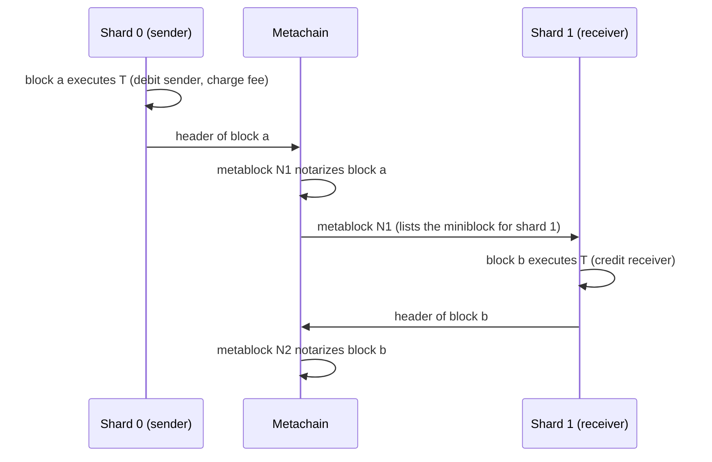

# Cross-shard support for Rosetta: analysis

This document works out what "making Rosetta work for cross-shard transactions" has to mean on MultiversX, compares the ways of doing it, and picks one. The chosen solution is specified in [CROSS_SHARD_AGGREGATOR_DESIGN.md](CROSS_SHARD_AGGREGATOR_DESIGN.md).

The solution has since been implemented in this repository and tested against mocks and a simulated network; it has not been run on a real network (design document, section 16). Protocol and tooling behaviour was established by reading the source of the pinned dependencies; each such claim names the file it comes from. Section 8 lists what still has to be confirmed on a network.

## 1. Conclusion

A separate middle application is the right shape, as proposed. It should present the whole network as **one linear chain whose blocks are the metachain blocks**:

- **Unified block N** corresponds to metachain block N: same index, same hash. It contains every transaction of every shard block that metablock N notarizes.
- **A cross-shard transaction appears as two linked transactions**, one in the unified block where the sender's shard executed it and one in the later unified block where the receiver's shard executed it. Each carries only the balance changes that really happened in that block.
- **An account's balance at unified block N** is its balance in its own shard, at the last block of that shard notarized up to N.

This keeps Rosetta's central guarantee, that an account's balance changes between two blocks by exactly the sum of the operations in between, without the aggregator holding any balance state of its own. Section 6 gives the argument.

The existing per-shard Rosetta stays as it is and becomes a backend. Two small, optional changes to it make the aggregator more exact (design document, section 11).

## 2. What does not work today

One Rosetta instance observes one shard and reports only operations on accounts of that shard (`IsAddressObserved`, `server/provider/networkProvider.go`). For a transfer from Alice in shard 0 to Bob in shard 1:

| Instance | What it shows for the transfer |
|---|---|
| Shard 0 | Alice's debit and the fee. Bob's credit is filtered out. |
| Shard 1 | Bob's credit, in a later block of a different chain. Alice's side is filtered out. |

Each instance is correct for its own shard. The gaps appear when someone needs the network as a whole:

- **Three chains, not one.** An integrator has to run three syncs with three block heights, and correlate them.
- **No link between the halves.** The README states that `related_transactions` is not supported because a single shard cannot resolve it.
- **Requests must be routed by hand.** `/account/balance`, `/construction/metadata` and `/construction/submit` only work on the instance of the right shard, and the instance does not check (audit finding A10).
- **Construction cannot be verified end to end.** `/construction/parse` returns a sender and a receiver operation, but no single chain ever shows both. The existing construction system test avoids the problem: both addresses in `systemtests/mesh_cli_config/*-construction-native.ros` decode to shard 0.

## 3. Protocol facts the solution rests on

**Shards and accounts.** An address belongs to exactly one shard, computed from its last byte with a mask; system contract addresses map to the metachain (`mx-chain-go/sharding/multiShardCoordinator.go`, `ComputeIdFromBytes`). The mapping is fixed for a given number of shards.

**Notarization.** Every metachain block lists the shard block headers it notarizes. The node API returns them as `notarizedBlocks` (shard, nonce, hash) on a metachain block (`mx-chain-go/node/external/blockAPI/metaBlock.go`). A metablock can notarize zero, one or several blocks of the same shard. Per shard, notarization is in nonce order and without gaps.

**Cross-shard execution is two steps.**

The destination shard takes cross-shard miniblocks from metablocks it has already received (`mx-chain-go/process/block/shardblock.go`, `createAndProcessMiniBlocksDstMe`). Block b therefore exists only after metablock N1, and is notarized by a later metablock: **N2 > N1, always**. Between N1 and N2 the transferred value is in no account.

**Smart contract results behave the same way.** A contract execution can emit results addressed to other shards. Each has its own hash, is created in one shard and executed in another, and so also has a source step and a destination step.

**The metachain is also a sender and receiver.** Staking, delegation and ESDT system contracts live on the metachain; rewards originate there. Value moves between shards and the metachain all the time.

**The hyperblock already exists.** The MultiversX proxy offers a "hyperblock": a metablock together with the shard blocks it notarizes, identified by the metablock's nonce and hash (`mx-chain-proxy-go/process/hyperblockBuilder.go`). By default it lists only transactions whose destination step is in that hyperblock ("fully executed"). The unified block proposed here uses the same anchor, so its index and hash can be checked against the proxy and the explorer. Its content differs, for the reason given in section 5.2.

**Epoch-start metablocks are checkpoints.** They record, for each shard, the last notarized header (`mx-chain-go/epochStart/metachain/epochStartData.go`). This gives the aggregator a cheap place to start indexing from.

## 4. What Rosetta and its tooling require

**Reconciliation.** For every account and every block, `balance(block) − balance(parent) = sum of successful operations on that account in the block`. `mesh-cli check:data` verifies exactly this. Any presentation that moves an operation to a different block than the one where the balance changed fails the check.

**One chain per network.** A network has one sequence of blocks with index, hash and parent. The specification offers `sub_network_identifier` for sharded chains, which exposes each shard as its own sequence.

**Transactions can be linked.** A transaction may list `related_transactions`, each with a direction: `backward` for a parent, `forward` for a child. The specification mentions cross-shard transactions as a use.

**What the SDK does with these** (read from `rosetta-sdk-go` v0.12.0, `storage/modules/block_storage.go`):

| Behaviour | Consequence for the design |
|---|---|
| The same transaction hash twice in one block is an error (`SeeBlock`). | Two halves must never share an identifier inside one unified block. |
| The same hash in two different blocks is accepted. `FindTransaction` returns the copy in the newest block. | Reusing the hash for both halves is legal, but a lookup then sees only the second half. |
| `FindRelatedTransactions` returns a transaction plus everything reachable through forward links, and the newest block among them. If a forward-linked child is not on chain yet, it reports the transaction as not found. | A source half that names its destination half as a forward link is treated as unconfirmed until the destination half arrives. That is the cross-shard completion rule we want. |
| A backward link to a transaction that is not in storage is skipped, not rejected. | Destination halves can always carry a backward link, even if the source half was never emitted. |
| The asserter checks related transactions for structure only. | Derived identifiers and links pass validation. |

## 5. Options considered

### 5.1 Expose each shard as a sub-network

A thin router: the request's `sub_network_identifier` selects the shard instance.

- **For:** trivial to build; follows the specification literally; nothing to prove.
- **Against:** it solves routing only. The integrator still follows three chains and links the halves alone.

**Decision:** not the solution, but worth offering as a secondary pass-through mode of the aggregator, because it is nearly free and useful for debugging.

### 5.2 Show each transaction once, when fully executed

This is the hyperblock's default view: the transfer appears in unified block N2 with both the debit and the credit.

- **For:** one transaction, one appearance; matches what `/construction/parse` predicts; matches what exchanges using hyperblocks see today.
- **Against:** the sender's balance really drops at N1. Showing the debit at N2 breaks reconciliation for every block from N1 to N2 − 1. The only repair is for the aggregator to report adjusted balances (chain balance plus everything in transit), which requires indexing every block of every shard and maintaining per-account in-transit sets for all history. Reported balances would then differ from on-chain balances, and funds already spent would look available for a few seconds.

**Decision:** rejected. It trades a provable, stateless design for a stateful one that reports numbers the chain does not hold.

### 5.3 Show each step where it happened, and link the steps (chosen)

The transfer appears at N1 with the sender's operations and at N2 with the receiver's.

- **For:** reconciliation holds by construction (section 6). No balance state. Every number shown is an on-chain number at a known block.
- **Against:** a transfer is two Rosetta transactions. Tooling that compares the on-chain transaction with the intended operations must follow the link.

The second point is handled by how the two halves are identified:

- The **source half keeps the real hash** `T`. This is the hash `/construction/hash` and `/construction/submit` return, so tracking starts on the right transaction.
- The **destination half gets a derived identifier**, `T-dst`, and carries the real hash in its metadata.
- The destination half always links `backward` to `T`. The source half links `forward` to `T-dst` whenever a destination half is certain to appear.

With the forward link in place, the SDK reports `T` as found only once `T-dst` is on chain, and returns both. A cross-shard transfer is thus "confirmed" at N2, with the debit, the fee and the credit all available.

Reusing the hash `T` for both halves was considered and dropped: a lookup of `T` would return only whichever half is newest, so neither state matches the intended operations.

The cost of this choice is that a deposit is observed under the identifier `T-dst`, not `T`. Integrators showing a hash to users must read it from metadata. Section 8 lists this as a question for them.

### 5.4 Order blocks without the metachain

Unified blocks could be built per round, taking whatever each shard produced in that round.

- **Against:** there would be no real block hash or parent, finality would have to be tracked per shard, and nothing could be cross-checked against the explorer. The metachain already provides order, identity and finality.

**Decision:** rejected.

### 5.5 Where to put the logic

| Option | Description | Assessment |
|---|---|---|
| **Middle application over shard instances** | A new service that speaks Rosetta to clients and to one Rosetta instance per shard. | **Chosen.** Reuses the validated per-shard logic unchanged; each part can be deployed, scaled and replaced alone; per-shard access remains available. Costs one extra network hop. |
| Single multi-shard process | One binary holding a provider per shard observer. | Fewer moving parts and no extra hop, but couples everything and requires reworking the existing binary. A reasonable later optimisation, since the aggregation logic would be the same. |
| Rebuild on the proxy's hyperblock API | Re-implement the transaction transformer on top of hyperblocks. | Rejected. The transformer reasons from a shard's point of view (intra-shard detection, invalid miniblocks, scheduled transactions). Re-deriving that would discard the part of the project that mainnet checks validate every 12 hours. |

## 6. Why the unified chain reconciles

**Definitions.** For shard S and metablock N, let the *frontier* `f_S(N)` be the highest nonce of shard S notarized by metablocks up to and including N. For an account `a` in shard S:

- `balance(a, N)` is the balance of `a` after shard block `f_S(N)`.
- `ops(a, N)` are the operations on `a` in shard blocks `f_S(N−1) + 1 … f_S(N)`.

**Assumptions.**

1. Every account belongs to exactly one shard, and that never changes.
2. Each shard instance reconciles on its own chain: for every block n, the balance change of `a` equals the sum of its operations in block n. This is what the existing scheduled `check:data` runs verify.
3. The metachain notarizes each shard's blocks in order and without gaps, and a final metablock is never reverted.
4. Each shard instance emits operations only for accounts of its own shard.

**Claim.** `balance(a, N) − balance(a, N−1)` equals the sum of `ops(a, N)`.

**Argument.** By assumption 3 the shard blocks of unified block N are the consecutive range `f_S(N−1) + 1 … f_S(N)`. Summing assumption 2 over that range, the intermediate balances cancel and leave `balance after f_S(N) − balance after f_S(N−1)`, which is the left side. By assumptions 1 and 4, no other shard's blocks contribute operations on `a`. ∎

Two consequences:

- The aggregator never needs to understand a transaction to stay correct. It only groups, relabels and links what the shard instances produce. Correctness of amounts remains the job of code that is already validated.
- If metablock N notarizes no block of shard S, the range is empty and the balance is unchanged, which is consistent.

The argument covers custom currencies too, since it is applied per account and per currency.

## 7. What the solution does not do

- **Metachain accounts are not covered at first.** System contracts are on the metachain. Operations on them are dropped, exactly as today, and `/account/balance` for such an address returns an error. Value sent to staking or delegation leaves the observed set of accounts and returns as rewards or withdrawals. User-account reconciliation is unaffected. Covering the metachain is a later phase that first needs the per-shard transformer validated against metablocks.
- **In-transit value has no account.** Between N1 and N2 the amount is nowhere. That is how the protocol works; the aggregator does not invent a holding account.
- **Completion of contract calls is best-effort.** A cross-shard contract call can spawn results across several shards over several blocks. The links connect them, but only a simple transfer has a completion point that can be stated in advance.
- **A change in the number of shards is not handled.** Assumption 1 would break. The aggregator checks the shard count at start-up and refuses to run on a mismatch.

## 8. To confirm before and during implementation

| # | Question | How to settle it |
|---|---|---|
| 1 | Does `mesh-cli` merge the operations of related transactions when it compares a confirmed transaction with its intent? The SDK function returns them; the caller lives in `mesh-cli`, whose source was not available here. | Run `check:construction` with a shard 0 → shard 1 scenario against a prototype. The project maintains its own `coinbase-mesh-cli` fork, so the helper can be adapted if needed. |
| 2 | Is N2 > N1 strict in all cases, including after Supernova? | Assert it in the aggregator and run over mainnet history. The design merges same-identifier transactions defensively, so a violation degrades gracefully. |
| 3 | After Supernova, blocks are notarized before their execution results are final. Does that only delay the unified tip, or can a notarized block stay unservable? | Run the aggregator on a Supernova testnet and watch the gap between the metachain tip and the unified tip. |
| 4 | Which half should carry the raw hash? The design gives it to the source half for tooling reasons (section 5.3). Integrators that mostly watch deposits may prefer the opposite. | Ask the integrators the aggregator is being built for. |
| 5 | Is the destination half of a transfer emitted in every outcome, including failure at the destination? Reading `failedMoveBalance.go` says yes for native transfers. | Cover with localnet test cases, including a transfer that fails at the destination. |
| 6 | Do the shard instances agree on configuration (currencies, `--handle-contracts`)? The aggregator cannot read their flags today. | Operational discipline at first; an upstream change to expose the configuration later (design, section 11). |
